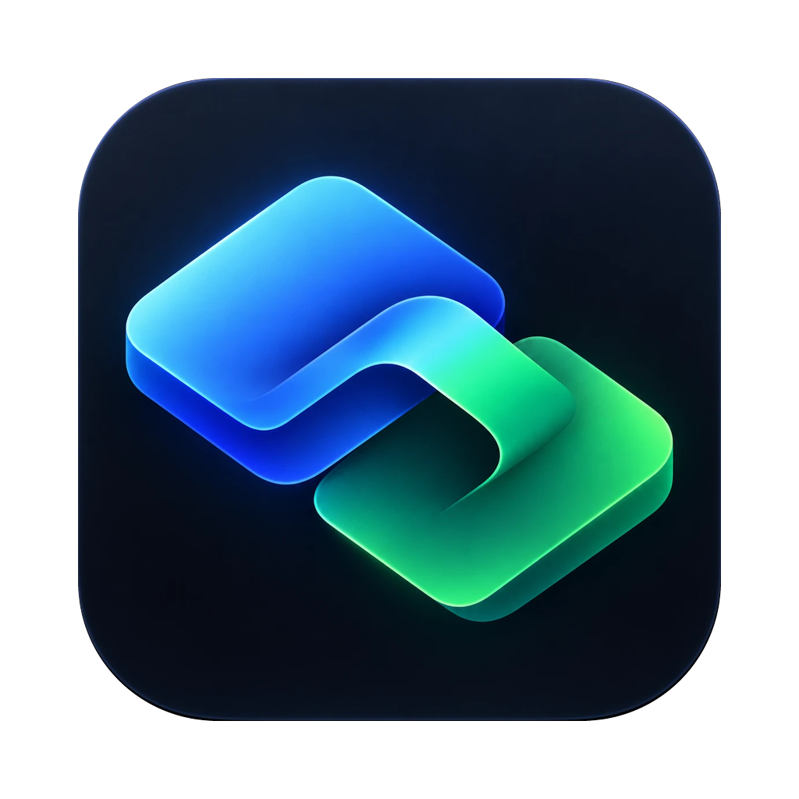

  

<h1 align="center">agentdeck</h1>

  Workspace terminal lokal untuk menjalankan dan mengoordinasikan coding agent dari satu jendela.

  <strong>Claude Code · Codex · PTY · MCP lokal · Tauri</strong>

agentdeck menyatukan beberapa CLI coding agent dalam pane yang bisa dibagi, lalu memberi mereka jalur kerja sama yang terlihat dan dikendalikan pengguna. Satu agent dapat meminta agent lain membuka pane, mengirim tugas, membaca layar pane lain, dan mengembalikan hasil melalui server MCP lokal.

Setiap agent tetap berjalan sebagai binary resmi milik providernya. agentdeck menyediakan terminal, lifecycle process, validasi kebijakan, antrean pesan, dan jembatan MCP tanpa mengambil alih login atau mengubah konfigurasi global agent.

> **Status proyek:** tahap awal. MVP inti sudah berjalan di macOS (Apple Silicon); Phase 0–4 selesai, pengujian ulang alur Codex masih berlangsung. Belum ada rilis biner: build sendiri dari sumber. Notarization dan updater belum ada.

> agentdeck tidak berafiliasi dengan, atau didukung oleh, Anthropic maupun OpenAI. Claude Code dan Codex adalah merek milik pemiliknya masing-masing. Kamu memasang dan login sendiri ke CLI tersebut, dan agent yang saling memberi tugas memakai kuota paketmu sendiri.

## Mengapa agentdeck

Workflow review antar agent biasanya memerlukan beberapa jendela terminal dan copy-paste manual. agentdeck membuat alur itu dapat dilacak dari satu workspace:

- buka Claude Code, Codex, atau shell dalam pane terpisah;
- susun pane secara horizontal atau vertikal dan fokus dengan keyboard;
- izinkan agent membuka agent lain melalui kartu persetujuan;
- kirim prompt antar pane lewat MCP dengan antrean dan status pengiriman;
- lihat log pesan, status pane, relasi parent–child, dan hasil kerja pada UI yang sama;
- hentikan pane dan seluruh grup prosesnya saat pengguna menutup aplikasi.

## Cara kerja

~~~text
┌────────────────────────────── agentdeck.app ──────────────────────────────┐
│ React + xterm.js                  Rust core                                │
│ ┌────────────────────────────┐   ┌──────────────────────────────────────┐ │
│ │ sidebar, split pane,       │   │ PTY · status · policy · delivery     │ │
│ │ approval card, message log │◀─▶│ MCP server · store                  │ │
│ └────────────────────────────┘   └──────────────────┬───────────────────┘ │
└─────────────────────────────────────────────────────┼─────────────────────┘
                                                      │ MCP over loopback
                         ┌────────────────────────────┴────────────────────┐
                         │                                                   │
                    Claude Code                                          Codex
                    pane p1                                               pane p2
~~~

Core Rust menjalankan setiap CLI langsung di PTY dan meneruskan output ke xterm.js. Agent memanggil tool agentdeck melalui HTTP MCP pada `127.0.0.1` menggunakan token unik per pane. Saat pesan siap dikirim, agentdeck menempelkannya ke PTY tujuan seperti input pengguna, kemudian mencatat statusnya di log.

## Batas keamanan

Keamanan berada di core Rust dan diterapkan pada setiap permintaan MCP:

- server MCP hanya bind ke loopback dan menolak `Host` asing atau `Origin` apa pun;
- setiap pane agent memakai token acak yang hanya hidup di memori dan environment proses anak;
- agentdeck tidak membaca keychain, cookie, `auth.json`, atau berkas kredensial provider;
- config global Claude Code dan Codex tidak ditulis; injeksi MCP dilakukan per peluncuran;
- agent yang dibuka oleh agent tidak menerima flag bypass izin;
- spawn, pengiriman peer, batas antrean, rate limit, dan pengaman putaran divalidasi di Rust;
- token dan kredensial tidak ditulis ke log, UI, atau pesan galat.

## Prasyarat

Untuk pengembangan di macOS:

- macOS 13 atau lebih baru;
- Xcode atau Command Line Tools;
- Rust stable melalui `rustup`;
- Node.js 22 atau lebih baru;
- pnpm;
- Claude Code dan/atau Codex yang sudah dipasang dan login untuk mencoba workflow agent.

Versi dan panduan lengkap ada di [docs/SETUP.md](docs/SETUP.md).

## Pasang

Satu perintah di Terminal macOS (Apple Silicon). Skrip membangun agentdeck dari kode sumber lalu memasangnya ke
Applications; prasyarat yang belum ada (Xcode Command Line Tools, Node.js 22+, pnpm, Rust) hanya ditampilkan perintah
pasangnya, tidak dipasang diam-diam:

~~~bash
curl -fsSL https://raw.githubusercontent.com/Nuzzy32/agentdeck/main/install.sh | sh
~~~

Jalankan perintah yang sama untuk memperbarui. Pilihan: `sh -s -- --dry-run` (hanya menampilkan langkah), `--ref <tag>`,
`--dest <folder>`. Windows dan Linux belum didukung; statusnya ada di [docs/PLATFORMS.md](docs/PLATFORMS.md).

## Mulai cepat

~~~bash
git clone https://github.com/Nuzzy32/agentdeck.git
cd agentdeck
pnpm install
pnpm tauri dev
~~~

Jendela agentdeck akan terbuka dalam mode pengembangan. Dari sana, pilih **Shell**, **Claude Code**, atau **Codex** pada launcher. Untuk membuat aplikasi macOS yang bisa dipakai sendiri:

~~~bash
pnpm tauri build
~~~

Output utama berada di `src-tauri/target/release/bundle/macos/agentdeck.app`; paket `.dmg` berada di folder `bundle/dmg/`. Build lokal belum ditandatangani sertifikat Developer ID, sehingga macOS dapat meminta konfirmasi saat pertama kali dibuka.

## Perintah pengembangan

| Tujuan | Perintah |
|---|---|
| Jalankan aplikasi | `pnpm tauri dev` |
| Typecheck UI | `pnpm typecheck` |
| Tes UI | `pnpm test` |
| Format Rust | `cargo fmt --manifest-path src-tauri/Cargo.toml` |
| Lint Rust | `cargo clippy --manifest-path src-tauri/Cargo.toml --all-targets -- -D warnings` |
| Tes Rust | `cargo test --manifest-path src-tauri/Cargo.toml` |
| Build aplikasi | `pnpm tauri build` |

Sebelum mengirim perubahan, jalankan pemeriksaan yang relevan dan coba perilaku terminal atau agent di `pnpm tauri dev`, bukan hanya melalui unit test.

## Struktur proyek

| Lokasi | Tanggung jawab |
|---|---|
| `src/` | UI React dan TypeScript: layout workspace, pane, launcher, approval card, message log, settings |
| `src-tauri/src/` | Core Rust: PTY, lifecycle process, status agent, policy, delivery, MCP, persistence |
| `src-tauri/icons/` | Sumber dan output ikon aplikasi Tauri |
| `tests/` | Fixture dan fake agent untuk pengujian integrasi |
| `spikes/` | Spike kelayakan PTY, throughput, screen reader, dan MCP |
| `docs/` | PRD, arsitektur, kontrak tool, UI/UX, keputusan, setup, dan progres |

## Dokumentasi

- [PRD](docs/PRD.md) — tujuan produk, kebutuhan, alur pengguna, dan roadmap.
- [Arsitektur](docs/ARCHITECTURE.md) — hubungan UI, core Rust, PTY, status, delivery, dan MCP.
- [Kontrak MCP](docs/MCP-TOOLS.md) — tool, argumen, batas, dan kode galat untuk agent.
- [UI/UX](docs/UI-UX.md) — struktur layar, interaksi, pintasan, status, dan token desain.
- [Rencana implementasi](docs/IMPLEMENTATION-PLAN.md) — urutan phase dan kriteria selesai.
- [Progress](docs/PROGRESS.md) — fitur yang sudah diuji, batasan yang diketahui, dan titik lanjut.
- [Phase 0](docs/PHASE-0.md) — bukti spike dengan CLI asli.
- [Setup](docs/SETUP.md) — instalasi, dependency, dan perintah harian.
- [Decision log](docs/DECISIONS.md) — keputusan arsitektur dan alasan teknisnya.
- [Platform](docs/PLATFORMS.md) — status macOS, Windows, dan Linux beserta blocker yang tersisa.
- [Research](docs/RESEARCH.md) — riset pendekatan dan produk pembanding.

## Batasan saat ini

agentdeck masih ditujukan untuk pemakaian pribadi di macOS. Beberapa bagian masih menunggu pengujian ulang dengan kapasitas server Codex yang tersedia, termasuk Codex sebagai reviewer dan pemanggil `pane_spawn`. Windows, Linux, akun cloud, sinkronisasi jarak jauh, updater, dan notarization belum menjadi target MVP.

## Kontribusi

Baca [AGENTS.md](AGENTS.md) sebelum mengubah kode. Dokumen tersebut menjelaskan batas keamanan, aturan provider, workflow pengujian, dan konvensi proyek. Perubahan pada kontrak MCP atau arsitektur harus dicatat di [docs/DECISIONS.md](docs/DECISIONS.md) dan dokumen terkait.

## Lisensi dan ketentuan provider

agentdeck dirilis di bawah [Apache License 2.0](LICENSE). Material pihak ketiga yang disertakan, termasuk aturan deteksi status dari [herdr](https://github.com/herdrdev/herdr) (Apache-2.0), tercatat di [THIRD_PARTY_NOTICES.md](THIRD_PARTY_NOTICES.md).

Claude Code dan Codex tetap tunduk pada ketentuan masing-masing provider; pastikan pemakaianmu sesuai dengan ketentuan paket yang kamu pakai. Pengguna memasang dan login sendiri ke binary resmi tersebut; agentdeck tidak menyediakan login, tidak mengubah binary, dan tidak meneruskan kredensial provider.
