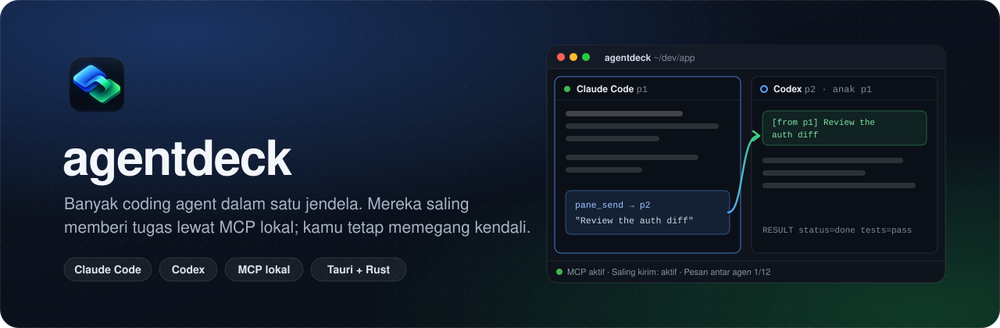
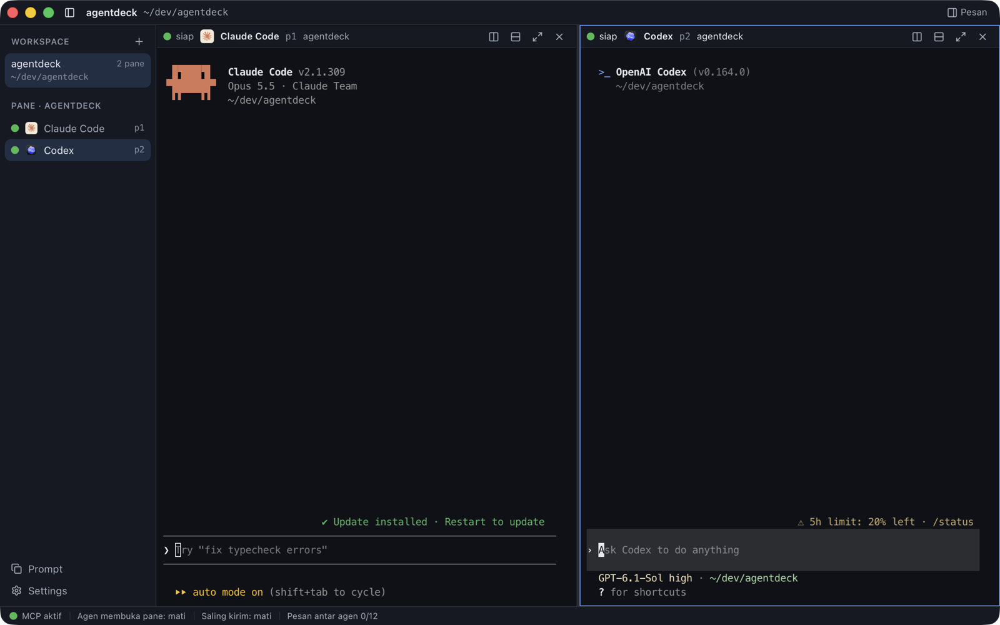
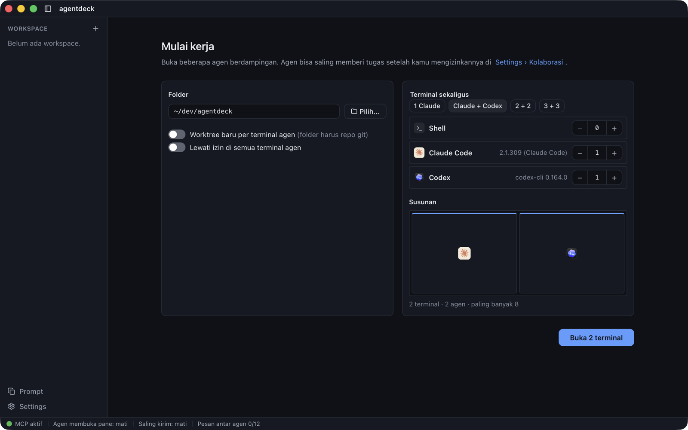
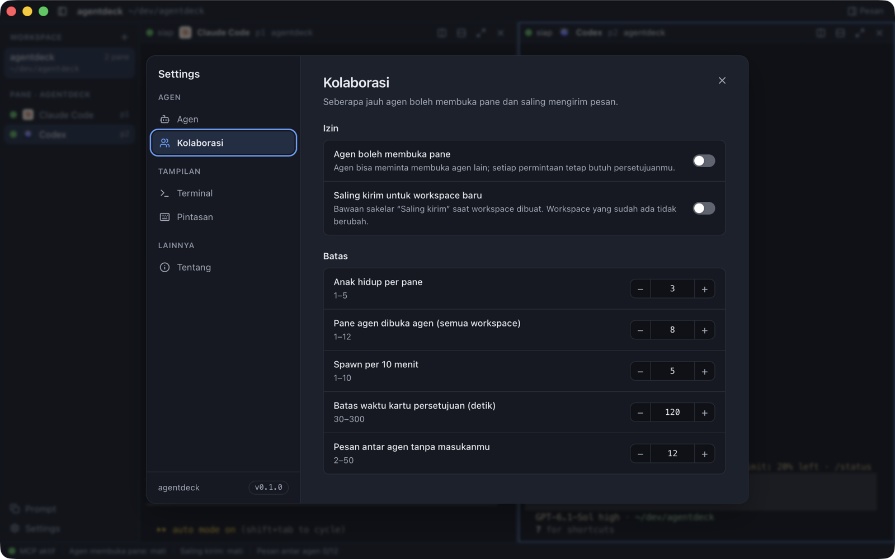
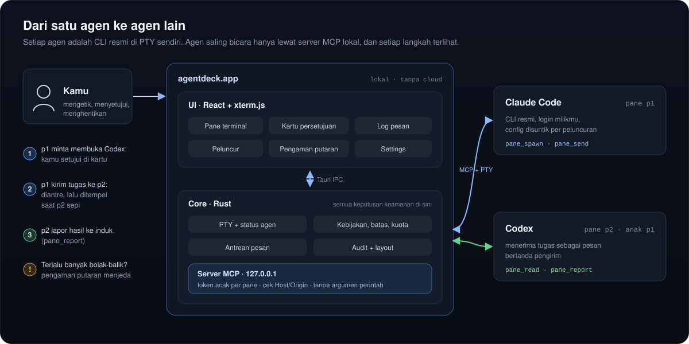

<p align="center">
  
</p>

<p align="center">
  <a href="https://github.com/Nuzzy32/agentdeck/actions/workflows/check.yml"></a>
  <a href="LICENSE"></a>
  
  
  
</p>

<p align="center">
  <a href="#tentang">Tentang</a> ·
  <a href="#fitur">Fitur</a> ·
  <a href="#cara-kerja">Cara kerja</a> ·
  <a href="#pasang">Pasang</a> ·
  <a href="#keamanan">Keamanan</a> ·
  <a href="#dokumentasi">Dokumentasi</a>
</p>

<br />

<p align="center">
  
</p>

## Tentang

**agentdeck** adalah terminal desktop untuk developer yang memakai lebih dari satu coding agent dalam pekerjaan yang
sama. Claude Code, Codex, dan shell berjalan berdampingan di pane yang bisa dibagi. agentdeck menyediakan PTY, status
agen, kartu persetujuan, antrean pesan, dan jembatan **MCP lokal** supaya agen bisa bekerja sama dengan cara yang
terlihat dan bisa dihentikan kapan saja.

Tujuannya sederhana: alur **pembuat–peninjau** tanpa copy-paste antar jendela. Satu agen bisa meminta agen lain
dibuka, mengirim tugas, membaca layar pane lain, lalu menerima hasilnya kembali. Setiap langkah lewat jalur yang kamu
kendalikan.

Setiap agen tetap berjalan sebagai **CLI resmi milik providernya**, dengan login milikmu sendiri. agentdeck tidak
mengambil alih login, tidak membaca kredensial, tidak mengubah binary provider, dan tidak menulis konfigurasi global
Claude Code atau Codex.

> [!NOTE]
> **Status: tahap awal.** Berjalan dan teruji di macOS Apple Silicon (Phase 0–4 selesai). Kode sudah terkompilasi dan
> lulus tes di Windows lewat CI, tetapi aplikasinya belum bisa dipakai di Windows. Belum ada rilis biner bertanda
> tangan; pasang dari kode sumber dengan satu perintah di bawah.

## Fitur

<table>
  <tr>
    <td width="50%" valign="top">
      <h3>Workspace multi-pane</h3>
      Buka beberapa Claude Code, Codex, dan shell sekaligus. Pane disusun otomatis dalam grid, bisa dibagi, diperbesar,
      dan dipindah dengan keyboard.
    </td>
    <td width="50%" valign="top">
      <h3>Agen saling memberi tugas</h3>
      Lewat server MCP lokal, agen bisa membuka agen lain (<code>pane_spawn</code>), mengirim tugas
      (<code>pane_send</code>), membaca layar (<code>pane_read</code>), dan melapor hasil (<code>pane_report</code>).
    </td>
  </tr>
  <tr>
    <td valign="top">
      <h3>Kamu tetap memegang kendali</h3>
      Setiap pane yang dibuka agen butuh persetujuanmu di kartu. Pengaman putaran menjeda agen yang terlalu lama saling
      membalas tanpa masukanmu.
    </td>
    <td valign="top">
      <h3>Pesan yang tidak mengganggu</h3>
      Pesan antar agen diantre dan baru ditempel saat pane tujuan sepi dan kamu tidak sedang mengetik, lengkap dengan
      penanda pengirim dan log.
    </td>
  </tr>
  <tr>
    <td valign="top">
      <h3>Worktree per agen</h3>
      Opsional: setiap agen mendapat git worktree dan branch sendiri, jadi beberapa agen bisa mengerjakan repo yang sama
      tanpa saling menimpa.
    </td>
    <td valign="top">
      <h3>Lokal dan aman sejak desain</h3>
      Tanpa cloud, akun, atau telemetri. Server hanya di <code>127.0.0.1</code> dengan token per pane, dan semua
      aturan keamanan ditegakkan di core Rust.
    </td>
  </tr>
</table>

<table>
  <tr>
    <td width="50%"></td>
    <td width="50%"></td>
  </tr>
  <tr>
    <td align="center"><sub><b>Mulai kerja</b> — pilih folder, jumlah agen, dan susunan pane</sub></td>
    <td align="center"><sub><b>Settings</b> — izin kolaborasi dan batas yang bisa kamu atur</sub></td>
  </tr>
</table>

## Cara kerja

<p align="center">
  
</p>

Core Rust menjalankan setiap CLI langsung di PTY dan meneruskan output-nya ke xterm.js. Agen memanggil tool agentdeck
lewat HTTP MCP di `127.0.0.1` dengan token unik per pane. Saat pesan siap dikirim, agentdeck menempelkannya ke PTY
tujuan seperti ketikan biasa, lalu mencatat statusnya di log. Rinciannya ada di [docs/ARCHITECTURE.md](docs/ARCHITECTURE.md)
dan kontrak tool di [docs/MCP-TOOLS.md](docs/MCP-TOOLS.md).

## Pasang

Satu perintah di Terminal macOS (Apple Silicon):

```bash
curl -fsSL https://raw.githubusercontent.com/Nuzzy32/agentdeck/main/install.sh | sh
```

Skrip membangun agentdeck dari kode sumber lalu memasangnya ke **Applications**. Jalankan perintah yang sama untuk
memperbarui. Prasyarat yang belum ada hanya ditampilkan perintah pasangnya, tidak dipasang diam-diam; skrip juga tidak
memakai `sudo`.

<details>
<summary><b>Prasyarat dan pilihan installer</b></summary>

<br />

| Perlu | Cek |
|---|---|
| macOS 13+ dengan Xcode Command Line Tools | `xcode-select -p` |
| Node.js 22+ dan pnpm | `node --version`, `pnpm --version` |
| Rust stable (rustup) | `cargo --version` |
| Claude Code dan/atau Codex, sudah login | `claude --version`, `codex --version` |

Pilihan (setelah `sh -s --`): `--dry-run` hanya menampilkan langkah, `--ref <tag>` memilih versi,
`--dest <folder>` memilih folder tujuan. Panduan lengkap ada di [docs/SETUP.md](docs/SETUP.md).

</details>

<details>
<summary><b>Kembangkan dari sumber</b></summary>

<br />

```bash
git clone https://github.com/Nuzzy32/agentdeck.git
cd agentdeck
pnpm install
pnpm tauri dev
```

| Tujuan | Perintah |
|---|---|
| Jalankan aplikasi | `pnpm tauri dev` |
| Typecheck dan tes UI | `pnpm typecheck` · `pnpm test` |
| Format, lint, tes Rust | `cargo fmt` · `cargo clippy --all-targets -- -D warnings` · `cargo test` (di `src-tauri/`) |
| Build aplikasi | `pnpm tauri build` → `.app` dan `.dmg` di `src-tauri/target/release/bundle/` |

Build lokal belum ditandatangani sertifikat Developer ID, jadi macOS bisa meminta konfirmasi saat pertama dibuka.
Perilaku terminal dan agen wajib dicoba di aplikasi yang berjalan, bukan hanya lewat unit test.

</details>

## Keamanan

Semua aturan keamanan ada di core Rust dan diterapkan pada setiap permintaan MCP:

- server MCP hanya bind ke loopback dan menolak `Host` asing atau `Origin` apa pun;
- setiap pane agen memakai token acak yang hanya hidup di memori dan environment proses anak;
- agentdeck tidak membaca keychain, cookie, `auth.json`, atau berkas kredensial provider;
- config global Claude Code dan Codex tidak ditulis; injeksi MCP dilakukan per peluncuran;
- agen yang dibuka oleh agen **tidak pernah** mendapat flag bypass izin;
- spawn, pengiriman pesan, batas antrean, rate limit, dan pengaman putaran divalidasi di Rust;
- token dan kredensial tidak pernah masuk ke log, UI, atau pesan galat.

## Platform

| Platform | Status |
|---|---|
| macOS 13+ · Apple Silicon | ✅ Didukung dan diuji di aplikasi berjalan |
| macOS · Intel | ❔ Belum diverifikasi |
| Windows 10/11 | 🚧 Terkompilasi dan lulus tes di CI; belum bisa dipakai sebagai aplikasi |
| Linux | ❔ Belum pernah dibangun |

Rincian per fitur dan blocker yang tersisa ada di [docs/PLATFORMS.md](docs/PLATFORMS.md).

## Dokumentasi

| Dokumen | Isi |
|---|---|
| [PRD](docs/PRD.md) | Tujuan produk, kebutuhan, alur pengguna, roadmap |
| [Arsitektur](docs/ARCHITECTURE.md) | UI, core Rust, PTY, status, pengiriman pesan, MCP |
| [Kontrak MCP](docs/MCP-TOOLS.md) | Tool, argumen, batas, dan kode galat untuk agen |
| [UI/UX](docs/UI-UX.md) | Layar, interaksi, pintasan, token desain |
| [Decision log](docs/DECISIONS.md) | Keputusan arsitektur beserta alasannya |
| [Progress](docs/PROGRESS.md) | Fitur yang sudah diuji, batasan, titik lanjut |
| [Platform](docs/PLATFORMS.md) | Status macOS, Windows, Linux |
| [Setup](docs/SETUP.md) · [Phase 0](docs/PHASE-0.md) · [Research](docs/RESEARCH.md) | Instalasi, spike kelayakan, riset pembanding |

## Kontribusi

Baca [AGENTS.md](AGENTS.md) sebelum mengubah kode: di sana ada batas keamanan, aturan provider, workflow pengujian,
dan konvensi proyek. Perubahan pada kontrak MCP atau arsitektur dicatat di [docs/DECISIONS.md](docs/DECISIONS.md).

## Lisensi

agentdeck dirilis di bawah [Apache License 2.0](LICENSE). Material pihak ketiga, termasuk aturan deteksi status dari
[herdr](https://github.com/herdrdev/herdr) (Apache-2.0), tercatat di [THIRD_PARTY_NOTICES.md](THIRD_PARTY_NOTICES.md).

<sub>agentdeck tidak berafiliasi dengan atau didukung oleh Anthropic maupun OpenAI. Claude Code dan Codex adalah merek
milik pemiliknya masing-masing dan tunduk pada ketentuan provider tersebut. Kamu memasang dan login sendiri ke CLI itu,
dan agen yang saling memberi tugas memakai kuota paketmu sendiri.</sub>
